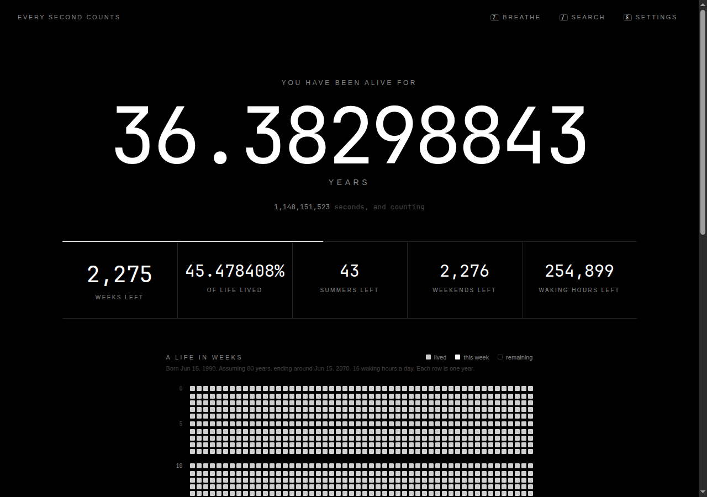
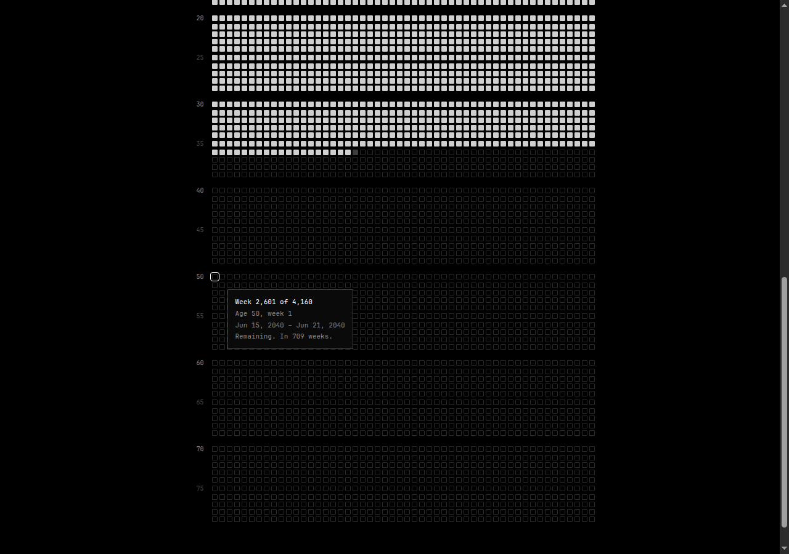
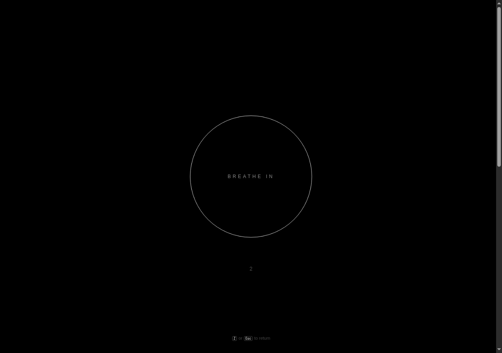
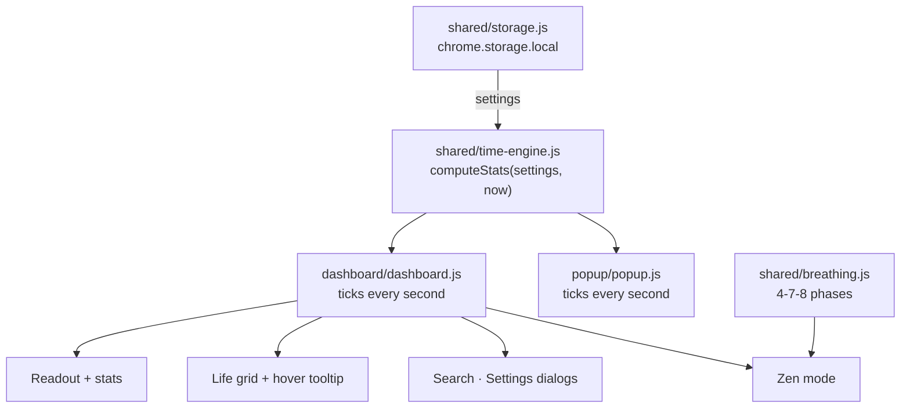

<p align="center">
  
</p>

<h1 align="center">NODAYSIDLE Every Second Counts</h1>

<p align="center">
  <strong>A minimal black-and-white dashboard of the life you have left, ticking in real time.</strong><br>
  Your age to eight decimals, the weeks remaining, and every week of a lifespan on one grid. Offline, private, and a little unsettling.
</p>

<p align="center">
  
  
  
  
  
  
  
</p>

<p align="center">
  
</p>

<p align="center">
  <a href="#why">Why</a> ·
  <a href="#features">Features</a> ·
  <a href="#privacy">Privacy</a> ·
  <a href="#install">Install</a> ·
  <a href="#usage">Usage</a> ·
  <a href="#architecture">Architecture</a> ·
  <a href="#development">Development</a> ·
  <a href="#license">License</a>
</p>

---

## Why

Most people know roughly how old they are and almost never think about how much is left. **Every Second Counts** puts the second figure in front of you: a live age readout, the weeks remaining, and a grid where each square is one week of your life. Lived weeks are filled, this week blinks, and the rest are empty.

It is calm on purpose: black, white, typography, and nothing else. It is **not** listed on the Chrome Web Store. Install it from source with Load unpacked.

---

## Features

- **Live age readout**: your age in years to eight decimals, plus seconds lived, updated on every wall-clock second.
- **What remains**: weeks left, percentage of life lived, and the summers, weekends and waking hours you have left.
- **A life in weeks**: a 52-column grid with one row per year, decade markers, and hover details for every week (dates, your age then, how many weeks ago or ahead).
- **Search**: type an age (`40`), a year (`2050`), a date (`2031-06-01`) or `week 2000` to jump to that week in the grid.
- **Zen mode**: press `Z` or `B` for a full-screen 4-7-8 breathing circle (in 4 seconds, hold 7, out 8).
- **Toolbar popup**: a compact live readout and a button that opens the full dashboard.
- **Zero dependencies**: plain HTML, CSS and ES modules. No build step, no framework.

<p align="center">
  
  
</p>

---

## Privacy

Everything runs in the extension page. There is no server, no account and no analytics.

- Settings are kept in **`chrome.storage.local`** on your device, or in `localStorage` when the page is opened outside the extension. Removing the extension deletes them.
- Manifest permissions: **`storage` only**.
- The extension's Content Security Policy sets `default-src 'self'` and `connect-src 'none'`, so the pages cannot make network requests even by mistake.
- Fonts are system fonts (`ui-monospace`, `SF Mono`, `system-ui`). Nothing is loaded from a CDN.

> **Config:** your birthdate and assumed lifespan are the `birthdate` and `lifespanYears` settings defined in `shared/storage.js` (defaults: 30 years before today, and 80). Set your own in the Settings dialog (`S`).

---

## Install

### Load unpacked in Helium Browser

```bash
git clone https://github.com/nodaysidle/nodaysidle-esm.git
```

1. Open `helium://extensions`. In Chrome, Brave or Edge, open `chrome://extensions` instead.
2. Turn on **Developer mode** (top right).
3. Click **Load unpacked** and select the cloned `nodaysidle-esm` folder (the one containing `manifest.json`).
4. Pin **Every Second Counts** from the puzzle-piece menu.
5. Click the toolbar icon, then **Open full dashboard**. The first visit asks for your birthdate.

After pulling changes, click the reload arrow on the extension's card in `helium://extensions`.

---

## Usage

| Key | Action |
| --- | --- |
| `Z` or `B` | Toggle Zen mode (4-7-8 breathing) |
| `/` or `Ctrl/Cmd + K` | Open search |
| `,` or `S` | Open settings |
| `Esc` | Close the open dialog, leave Zen mode, or clear the search highlight |
| `↑` `↓` `Enter` | Move through and pick search results |

Shortcuts work on the full dashboard. Hover any square in the grid to see its dates.

### How the numbers are counted

- **Age** counts from local midnight on your birthdate. The fraction runs against the current birthday year, so it reads exactly `N.00000000` on each birthday.
- **Grid rows** start on birthdays. The 52nd week of each row takes the extra 1–2 days so rows stay aligned.
- **Summers** are northern-hemisphere summers (21 Jun – 22 Sep) that end before your assumed lifespan runs out.
- **Weekends** are the Saturdays left before that date. **Waking hours** are the remaining hours × waking hours per day ÷ 24.

---

## Architecture



```
nodaysidle-esm/
├── manifest.json            Manifest V3: popup action, storage permission, offline CSP
├── icons/                   16, 48, 128 px
├── popup/                   popup.html · popup.css · popup.js
├── dashboard/               dashboard.html · dashboard.css · dashboard.js
├── shared/
│   ├── time-engine.js       Lifespan math, pure functions of (settings, now)
│   ├── storage.js           Settings with per-field validation and defaults
│   └── breathing.js         4-7-8 phase timing
├── tests/time-engine.test.js
└── docs/media/              README screenshots
```

| Feature | File |
| --- | --- |
| Age readout, every second | `dashboard/dashboard.js` (`tick`, `loop`), `popup/popup.js` |
| Weeks left, % lived, summers, weekends, waking hours | `shared/time-engine.js` (`computeStats`) |
| 52-week grid, decade markers, hover details | `dashboard/dashboard.js` (`buildGrid`, `describeWeek`), `dashboard/dashboard.css` |
| Zen mode | `shared/breathing.js`, `dashboard/dashboard.js` (`openZen`), `dashboard/dashboard.css` (`.breath-circle`) |
| Search | `dashboard/dashboard.js` (`searchResults`) |
| Settings | `dashboard/dashboard.html` (`#settings`), `shared/storage.js` |
| Shortcuts | `dashboard/dashboard.js` (the `keydown` listener) |

---

## Development

No install step. Node.js 22 or newer runs the checks.

```bash
node --test tests/                                   # lifespan math, 4-7-8 phases, settings validation
node --check shared/*.js dashboard/*.js popup/*.js   # syntax
! grep -rnE "https?://|fetch\(|XMLHttpRequest|WebSocket" dashboard/ popup/ shared/ manifest.json
```

See [`AGENTS.md`](AGENTS.md) for the project's invariants and conventions.

---

## License

[MIT License](LICENSE) © 2026 [nodaysidle](https://github.com/nodaysidle)
